# How ai-router works

Diagrams of what the router does today: what a workspace decides, how an app's request becomes a run, what
one run does, and where its model and tool calls go. The words are the glossary's, in
[`.agents/domain-model.md`](.agents/domain-model.md); the code each step names is the place to read for how.
What happens inside the loop itself (turns, tool loading, the system prompt) is agent-core's, in its own
[`HOW-IT-WORKS.md`](../agent-core/HOW-IT-WORKS.md).

- [The pieces](#the-pieces)
- [What a workspace decides](#what-a-workspace-decides)
- [From a request to a resolved run](#from-a-request-to-a-resolved-run)
- [One request on `/v1`](#one-request-on-v1)
- [One run](#one-run)
- [A model call](#a-model-call)
- [A tool call](#a-tool-call)
- [Waiting for the app](#waiting-for-the-app)
- [How a run ends](#how-a-run-ends)
- [What the app gets back](#what-the-app-gets-back)
- [An agent call as an MCP task](#an-agent-call-as-an-mcp-task)
- [Run events](#run-events)
- [Conversations and sessions](#conversations-and-sessions)
- [The snapshot](#the-snapshot)

## The pieces

An app reaches the router with a **workspace key**, and a person with a session. The app sees only agents.
The models and MCP servers behind them are the router's own.

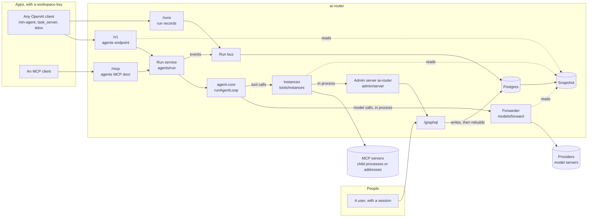

There is no raw model or tool endpoint. The forwarder is called only by a run's `fetch`, and the admin
server only through the instances, as any other server a run reaches.

Who a request is from is read once, from its credential (`auth/caller`):

| Credential | Caller | Reaches |
| --- | --- | --- |
| A workspace key, as `Authorization: Bearer` or `x-api-key` | An app, as its workspace | `/v1`, `/mcp`, `/runs`. A session token sent there is refused |
| A session cookie or token | A user, or an admin | `/graphql` and the UI. Under `SECURE_LOCAL_NET`, whoever opens the UI is the admin |
| None: handed over in process | A run, as `RunCaller` | The admin server's tools, as far as its workspace's roles reach |

## What a workspace decides

A workspace owns nothing. It is a set of choices about agents and servers that live on their own, and its
keys carry those choices to every request.

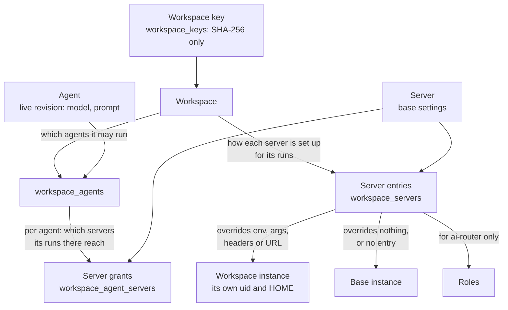

- **A grant reaches, an entry configures.** A run reaches exactly the servers its workspace granted its
  agent, and none without a grant. An entry never grants a server; it only decides which instance a granted
  one is called on.
- **The agent's document decides its models.** Its own `tools.servers` is ignored (a save warns).
- **Only a person grants.** `setWorkspaceAgentServers` is people-only, and no admin-server role reaches it,
  so a run can never widen its own reach.
- **Roles live on the entry for `ai-router`** and nowhere else. They decide which management tools a
  granted run is listed, and the schema's permissions guard each call.

## From a request to a resolved run

Three layers are stacked weakest first and merged by agent-core's `resolveAgentSpec`, and then the app's
parts are stacked on the result by `stackAppParts` (`agents/layers` `resolveRun`).

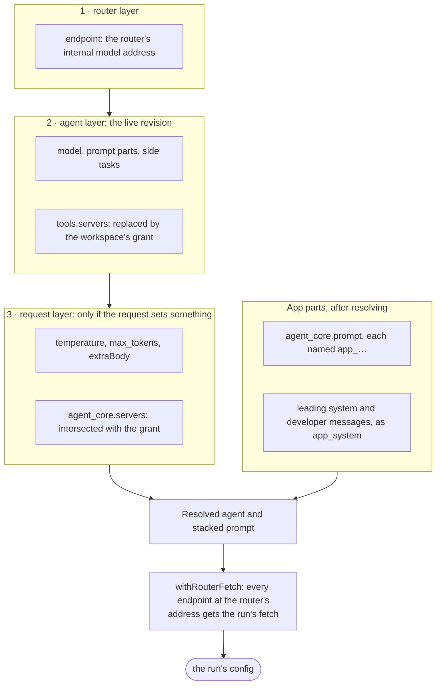

What passes into those layers is read first, by `agents/request` `readRunRequest`. Every field the router
doesn't read itself goes to the model, so an OpenAI client's request goes through as it would to OpenAI,
unless the agent locks it (agent-core's `checkLockedFields`, against the agent resolved alone):

| A request field | Goes to | Refused when |
| --- | --- | --- |
| `model` | Picks the agent. Never changes its model | The workspace may not run it: 404 `model_not_found` |
| `messages` | Leading `system`/`developer` → `app_system`; the rest → the conversation; trailing `tool` messages → answers to a waiting run | Empty, or nothing after the system messages |
| `temperature` | `model.temperature` | Out of range |
| `max_tokens`, `max_completion_tokens` | `model.maxTokens` | Not a whole number, or the two disagree |
| `reasoning_effort` | `model.reasoningEffort` | |
| `response_format`, `parallel_tool_calls` | `model.extraBody` | Not the right shape |
| `tools` | App tools, handed back when called | More than the settings allow, a name of the loop's own, or not function tools |
| `agent_core.prompt` | App parts | agent-core's `parseAppParts` can't read one |
| `agent_core.servers` | Narrows the workspace's servers | |
| `agent_core.progress` | Progress events in the answer | |
| `user` | Recorded on the run | |
| `n` | | Above 1 |
| `stream_options` keys but `include_usage` | | Refused, naming the key; under `unlistedFields: ignore`, dropped and named in `X-AI-Router-Ignored` |
| A field the agent locks (`model.lockedFields`) | | Refused, naming it; under `unlistedFields: ignore`, dropped and named in `X-AI-Router-Ignored` |
| Any other field (`top_p`, `seed`, `stop`, a provider's own) | `model.extraBody` | |

Nothing above the agent names an endpoint or a model, and a sampling setting never reaches a side task. An
app part that breaks its agent part's `allowedModes` is dropped, not refused: a notice event, and
`agent_core.warnings` on the answer.

## One request on `/v1`

`POST /v1/chat/completions`, in `agents/routes` `createAgentRoutes`.

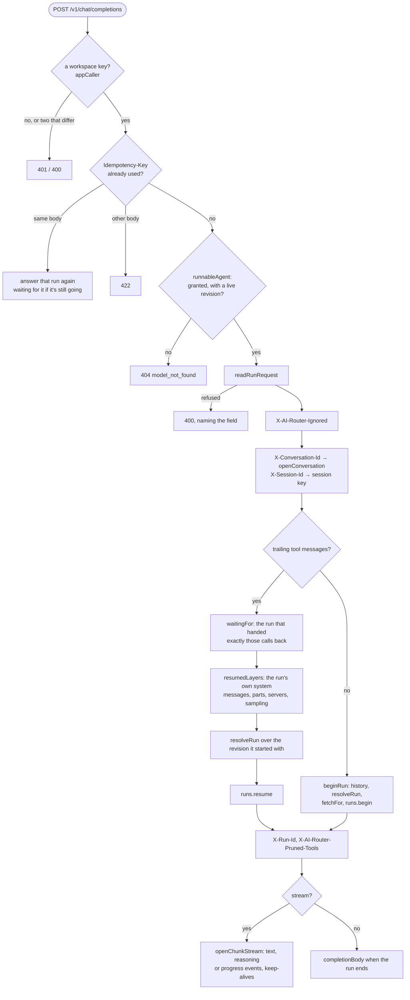

- **Before the run exists**, a refusal is OpenAI's `{ error: { message, type, code } }` and carries no
  `X-Run-Id`. A run the router never recorded leaves no trace.
- **Every header is set before the first byte**, so a streamed answer carries them too.
- **A dropped connection** cancels the run, unless the request sent an `Idempotency-Key`: that run goes on to
  its timeout, so the retry gets its answer.
- **`/mcp`** (`agents/mcp`) builds the same request from a tool call's `message`, with no app tools and no key,
  and calls the same `beginRun`, so its runs never wait. A call may ask to run as an MCP task: see
  [An agent call as an MCP task](#an-agent-call-as-an-mcp-task). `GET /v1/models` lists the same agents
  (`runnableAgents`), each marked `agent_core: { kind: "agent", prompt }` with its parts' names and
  `allowedModes`, never their text.

## One run

`agents/run` `createRunService`: `begin` records the run, and `run` drives one stretch of it, from its start
or a resume to its answer or a wait.

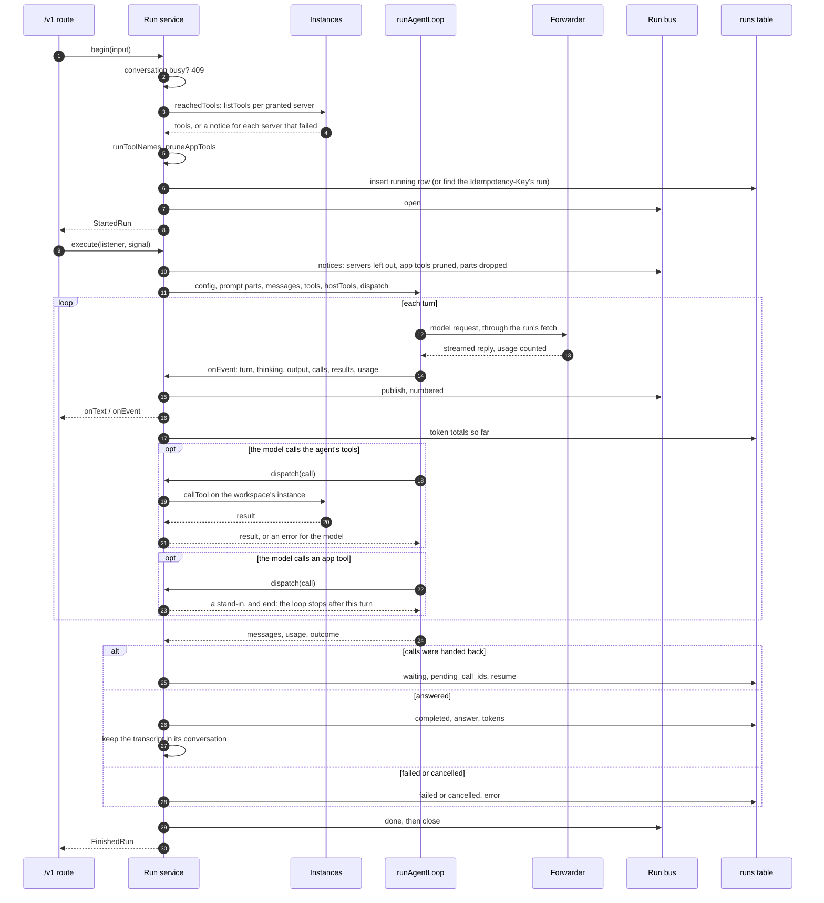

- **The run keeps the revision it started with.** A revision promoted while it runs applies to the next one.
- **A server that won't start or list** is left out with a notice; it never fails the run.
- **Each tool gets a model name** by `agents/tool-names` `runToolNames`: `<server>__<tool>`, with any character
  outside `[a-zA-Z0-9_-]` made `_`, and a name over 64 characters or shared by two tools cut and hashed. The
  map back to the server and tool lives for this run only.
- **An app tool that duplicates the agent's own** is pruned (`agents/app-tools`): always for the same name, and
  across servers only under `pruneAppToolsAcrossServers`. The agent's server answers it instead.
- **Every app tool call gets an id the router minted** (`freshCallId`), in the answer, the events and the
  transcript alike, and a repeated identical call is handed back again, never answered from the first.
- **The loop's `session` is the run id,** which agent-core sends as `X-Session-Id` on each model call, so a
  sticky pool (`models/affinity`) keeps one run's calls on one target.

## A model call

The router layer sets every agent's endpoint to `MODELS_BASE_URL`, an address that resolves nowhere. The
run's `fetch`, made once per workspace and agent by `Forwarder.fetchFor`, answers it in process. An agent
with an `endpoint.baseUrl` of its own is called directly, with no key and no `fetch`.

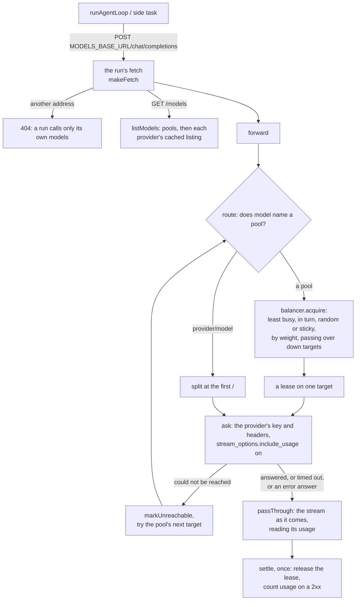

- **A pool call goes to the next target only when nothing reached the first**, so no provider has done any
  of it. A timeout or an error answer is passed back.
- **Usage counts under the run's workspace and agent**, and under the pool as well as the target it went to
  (`models/usage`, written every few seconds).
- **Health checks** (`models/health`) ask each provider an enabled pool uses for its model list once a round,
  and a target found down is passed over until a later round finds it up.

## A tool call

The run's `dispatch` maps the model's name back to a server and tool and calls `ToolServices.callTool` with
the run's workspace, so the workspace's instance and secrets are used.

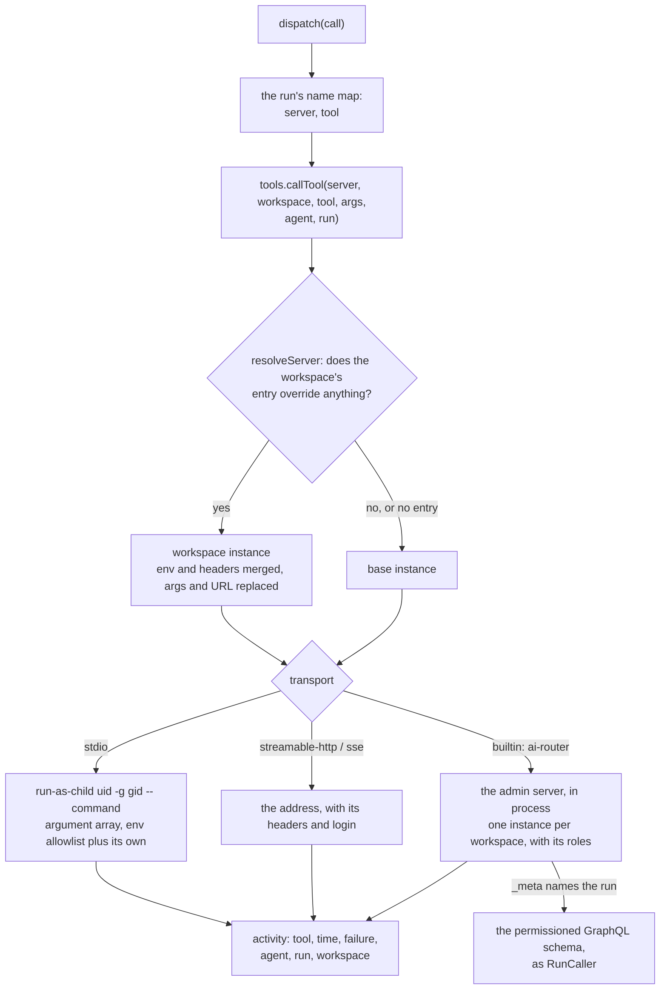

- **A stdio instance starts on its first call** and stops when idle. A workspace instance runs as its entry's
  own uid with the server's group, in the server's install folder, with a HOME of its own.
- **The admin server's tools are listed as far as the roles reach** (`canReachField`), and every call is
  checked by the same permissions `/graphql` has. The run is named in `_meta` by the router's dispatch,
  never by the model.
- **A run never changes or restarts `ai-router`**, never grants a server, and never promotes: its saves are
  drafts, unless a user turned on auto-promote for that agent.
- **A tool's error reaches the model as an error,** and the loop goes on.

## Waiting for the app

An app tool call pauses the run. The app answers it with an ordinary OpenAI tool round trip, and the same
run carries on under the same run id.

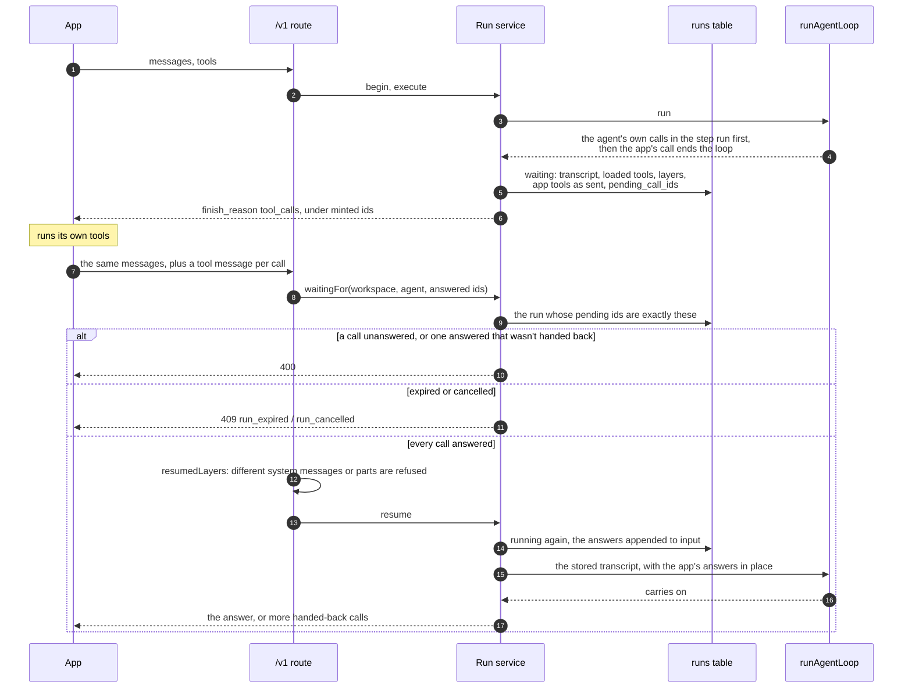

- **A wait survives a restart.** Everything the loop needs is on the row (`runs.resume`), and a resume rebuilds
  agent-core's state from it.
- **Waiting doesn't count toward the run timeout.** Waiting past `RUN_DEFAULTS.waitTimeoutHours` expires it.
- **The app's tools are pruned again on each resume**, against the agent's tools as they are now.
- **A resume takes over the run's `Idempotency-Key`**, or clears it, so a retry of the resume gets the
  resume's answer.

## How a run ends

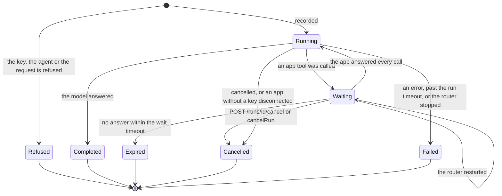

- **A refused request is not recorded.** Everything from `running` on is, with the revision it ran.
- **Every end sends one last `done` event**, and a run that was going when the router stopped is marked failed,
  with its `done`, at the next boot (`runs.recover`).
- **Once a run has ended, its record and events never change.** A cancel of an ended run answers with it
  unchanged. Only retention deletes it.

## What the app gets back

| The app sends | It gets |
| --- | --- |
| `stream: true`, no `agent_core.progress` | `chat.completion.chunk`s: the answer as `content`, the run's thinking and a line per tool call and result as `reasoning_content`, which chat clients fold away |
| `stream: true`, `agent_core.progress: true` | The answer as `content`, and each run event as a chunk with empty `choices` and `agent_core.event`, never as reasoning too |
| No `stream` | One `chat.completion` when the run ends, with `agent_core: { runId, events }` beside `choices` when progress was asked for |
| `stream_options.include_usage` | A usage chunk at the end |
| A repeated `Idempotency-Key` | The same run's answer, without its events; the app reads them from `/runs/<id>/events` |

Every answer carries `X-Run-Id`. `X-AI-Router-Ignored` names fields dropped under `unlistedFields: ignore`,
`X-AI-Router-Pruned-Tools` the app tools left out, and `agent_core.warnings` the app parts dropped (beside
`choices`, or on the finish chunk). A stream gets a `: keep-alive` comment every `heartbeatSeconds`.

Afterwards, or while it runs, the same key reads its workspace's runs at `/runs`:

| | |
| --- | --- |
| `GET /runs` | Its runs, newest first; `?session=` for one session's |
| `GET /runs/<id>` | Agent, revision, session, conversation, status, input, timings, usage, error |
| `GET /runs/<id>/events` | The events as JSON, or live with `Accept: text/event-stream`, rejoined with `Last-Event-ID` |
| `POST /runs/<id>/cancel` | Cancels a running or waiting run, with an optional `{ reason }` |

Another workspace's run is the same 404 as one that never was. Refusals here are `{ error, code }`.

## An agent call as an MCP task

A `/mcp` call that asks to run as a task (MCP's 2025-11-25 tasks) is answered at once, and the run goes on without
the connection. The task is the run: `agents/mcp-tasks` answers every task method from the runs table and the run bus,
so there is no second store.

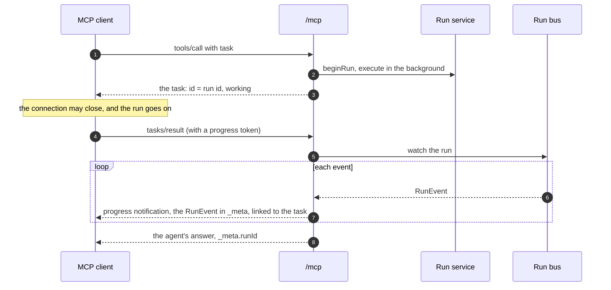

| Task method | Does |
| --- | --- |
| `tasks/get` | The run as a task: running is `working`, waiting is `input_required`, completed `completed`, failed and expired `failed`, cancelled `cancelled` |
| `tasks/result` | Waits for the run's end, sending each of its events on the way, then answers as the call would have |
| `tasks/list` | The workspace's runs, newest first |
| `tasks/cancel` | Cancels the run, as `POST /runs/<id>/cancel` does. An ended task can't be cancelled |

A key reaches only its own workspace's tasks. A caller that only polls `tasks/get` sees the status, and any caller can
also follow `/runs/<id>/events` with the same key.

## Run events

Events are agent-core's `RunEvent`, unchanged, written as JSON. The run bus (`agents/run-bus`) numbers them
and hands each to every follower, and writes them to the table folded.

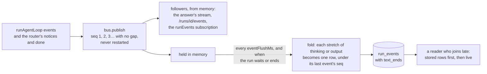

- **Stored `seq`s increase with gaps.** Never number stored rows, and never assume `seq + 1` is stored.
- **A stretch still going** stays in memory until it ends, or for `RUN_DEFAULTS.streamHoldMs`, and is then stored
  in parts.
- **A reader who had part of a stretch live** gets only the rest of its row, by `text_ends`.
- **The run's input is not an event.** What each request added is on `runs.input`, since apps already show their
  own input.

## Conversations and sessions

Both are optional, named by the app, and kept per workspace.

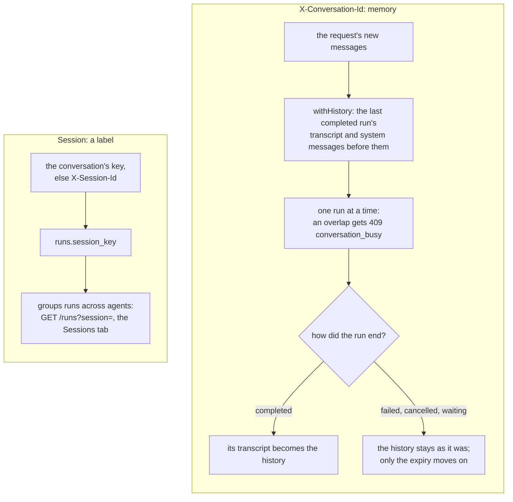

- **A conversation belongs to one workspace and one agent.** Once it has history, a request that sends assistant
  or tool messages is refused, except tool messages that answer its waiting run.
- **App parts are not kept**: each request sends its own. System messages are, until a request sends new ones.
- **An idle conversation is deleted** after `CONVERSATION_DEFAULTS.idleHours`, never while it has a run going.
  Its runs stay, naming none.
- **A session never decides how a run goes.** Nothing reads it but the listings.

## The snapshot

Requests never read routing from the database. `db/snapshot` holds keys, workspaces and their grants and
entries, agents and their live documents, providers, pools, servers and settings in memory.

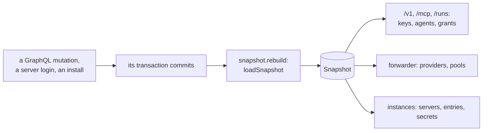

- **A request reads the snapshot once** and routes by that copy to its end.
- **One process owns a database**: a Postgres advisory lock taken at boot, so a second router refuses to start.
- **Boot** waits for Postgres, takes the lock, runs the migrations, upgrades stored documents and waiting runs
  once (`agents/upgrade`), checks that children are walled off, then marks the runs a stop cut short as failed
  and starts the timers: usage, pool health, activity, and run retention and expiry.
